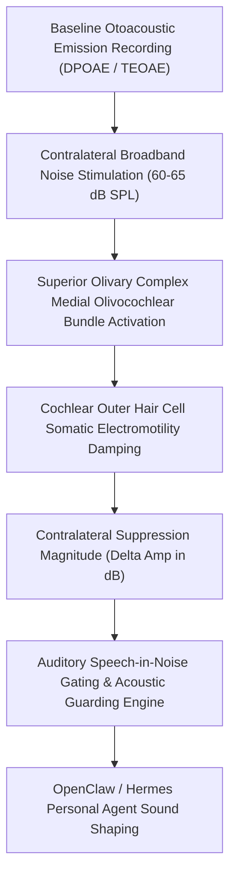

# Acoustic MOC Efferent Contralateral Suppression Skill

[](LICENSE)
[](https://www.python.org/)
[](requirements.txt)
[](mcp_server.py)
[](SKILL.md)

Zero-dependency sovereign personal agent skill for non-invasive evaluation of Medial Olivocochlear (MOC) Efferent Contralateral Suppression of Otoacoustic Emissions (CAS-OAE), speech-in-noise gating, and auditory protective resilience.



## Features
- **Deterministic Math**: Pure Python standard library implementation with zero external dependencies.
- **Auditory Neurophysiology Standards**: Formulates contralateral acoustic stimulation suppression, baseline signal-to-noise gating, and MOC gain reduction.
- **Cocktail Party Problem & Listening Fatigue**: Identifies subclinical central auditory processing deficits in noisy environments.
- **Model Context Protocol (MCP)**: Native JSON-RPC tool integration for LLMs and autonomous agents.

## Quickstart

```python
from client import AcousticEfferentSuppressionClient

client = AcousticEfferentSuppressionClient()
result = client.evaluate_contralateral_suppression(
    baseline_oae_amplitude_db_spl=11.2,
    noise_conditioned_oae_amplitude_db_spl=9.4,
    contralateral_noise_db_spl=65.0
)
print("Suppression Magnitude:", result["suppression_magnitude_db"], "dB")
print("Efferent Score:", result["efferent_gating_score"])
print("Classification:", result["classification"])
```

## License
Apache-2.0
